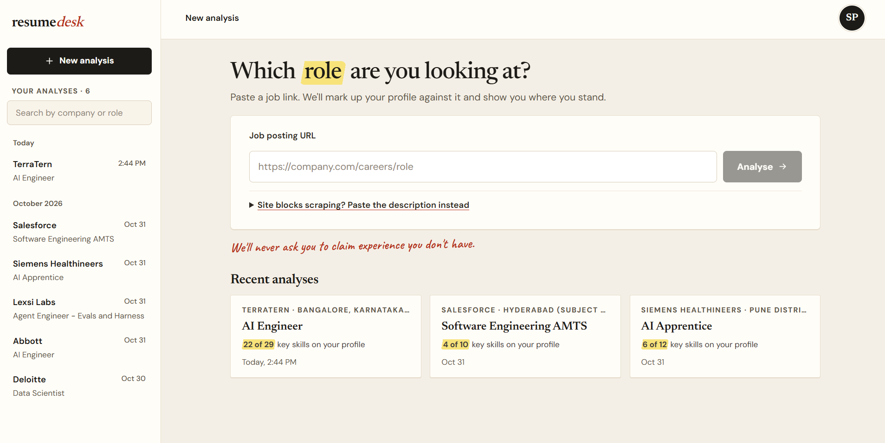
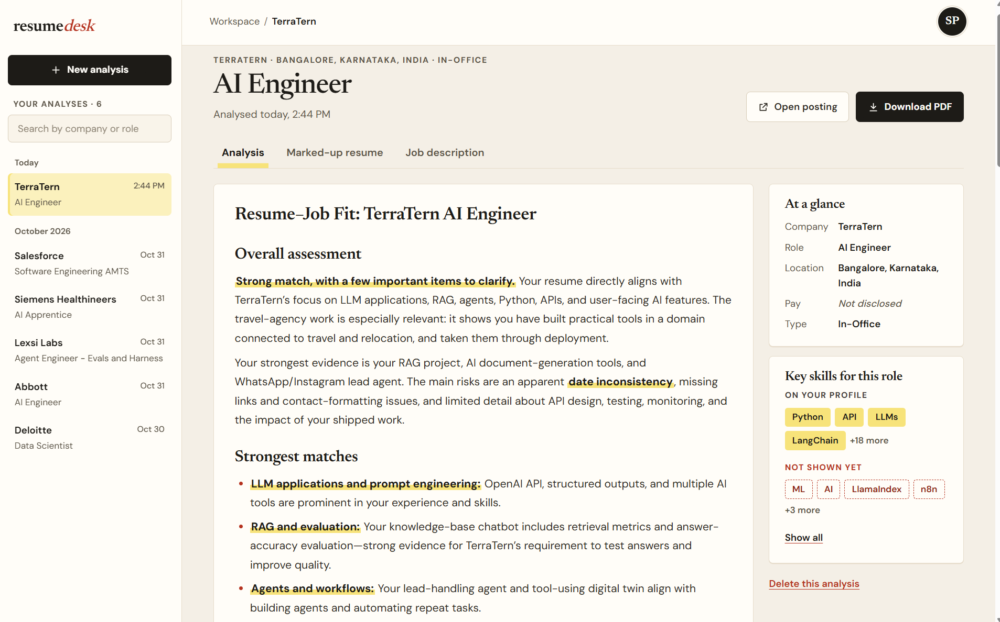
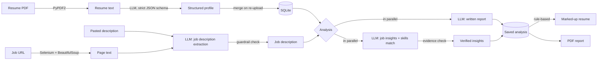

<div align="center">

# resume*desk*

**Your resume, marked up against the job you actually want.**

Save your professional profile once, paste any job posting, and get an honest gap analysis,
a skills match backed by evidence from your own profile, and a marked-up copy of your resume.


</div>

---

## Screenshots

**Start a new analysis.** Paste a job link (or the description text) and see your recent analyses at a glance.



**Read the report.** The written analysis, the job's key facts, and which of the role's skills your profile shows.



---

## Contents

- [Features](#features)
- [How it works](#how-it-works)
- [Tech stack](#tech-stack)
- [Getting started](#getting-started)
- [Configuration](#configuration)
- [Project structure](#project-structure)
- [Components](#components)
- [API reference](#api-reference)
- [Data and security](#data-and-security)
- [Testing](#testing)
- [Known limitations](#known-limitations)

---

## Features

### Profile

- **Built from your resume.** Upload a PDF and its text is converted into a structured profile:
  basics, experience, projects, skills, education, certifications and achievements.
- **Fully editable.** Every section can be edited in a side drawer, and you can add
  *additional context*: facts that aren't on your resume but should count (tools you've
  used, client-facing work, availability).
- **Re-uploading merges, never replaces.** A new resume is merged into your existing profile:
  - Fields you edited by hand are kept.
  - Fields that came from your last resume are updated.
  - New entries are added.
  - Entries missing from the new resume are kept.
  - Entries you deleted aren't brought back.
  - A message after each upload says what was added, updated and kept.
- **Undo last upload.** Restores the profile and resume PDF from before the latest upload.
  It goes back one upload, and only until the profile is edited again.
- **Improvement tips.** A sidebar card on the profile page suggests quick wins, such as adding a
  headline, a summary, highlights for a role, or links for your projects.
- **Transparent.** *View JSON* shows exactly what is sent to the model.

### Job analysis

- **Paste a link or the text.** Job pages are opened in headless Chrome and the job
  description is extracted. If a site blocks scraping, paste the description instead.
- **Guardrails against made-up postings.** Login walls, captchas, error pages and job lists
  are rejected rather than analysed, so a report is never written against an invented job.
- **Written report.** An overall assessment, your strongest matches, the gaps, and specific,
  honest suggestions. It never suggests claiming skills or experience you don't have.
- **At a glance.** Company, role, location, pay and work mode, quoted in the posting's own words.
- **Evidence-checked skills match.** Every skill the role asks for, split into *on your profile*
  and *not shown yet*. A skill counts as matched only if its evidence is actually in your profile.
- **Marked-up resume.** Your profile laid out as a resume, marked like a reviewer would:
  - **Yellow highlights:** what already works for this role.
  - **Red-pen notes:** what to fix. These cover weak openers ("Responsible for…"), first person,
    very long bullets, roles with no numbers, projects without links, an unfinished degree not
    marked "expected", and key skills the resume doesn't show.
  - This step is rule-based and uses no AI.
- **PDF report.** A download in the same design as the web app, with the analysis, the
  marked-up resume and the job description.

### Workspace

- **Accounts.** Sign up with email and password. Each user's profile and history are private.
- **History.** Every analysis is saved and grouped by date. You can search it by company or role,
  reopen past analyses, or delete them.
- **Accurate old reports.** Each analysis stores a snapshot of the profile it used, so older reports
  stay accurate after you edit your profile.

---

## How it works



1. **Profile.** The resume PDF's text is extracted with PyPDF2. The extraction model then turns it
   into the profile schema using strict structured output. The profile is validated with Pydantic
   and saved.
2. **Job description.** A URL is opened in headless Chrome, and scripts, navigation and footers are
   stripped. Pages with fewer than 300 characters of readable text are rejected outright. The
   model then extracts the role, responsibilities, requirements, company, pay and location into
   Markdown. If the page isn't a single job posting, the request stops there.
3. **Analysis.** Two model calls run in parallel:
   - The **report**, written by the analysis model.
   - The **insights**, a strict JSON object with the job's key facts and the skills match. Every
     "matched" skill must quote evidence that exists in the profile; otherwise it is moved to
     "missing". A second pass moves any "missing" skill that the profile's skills or tech stack
     list explicitly over to "matched".
4. **Markup and PDF.** The marked-up resume is computed from the stored profile snapshot and
   insights each time an analysis is opened, so improvements to the rules also apply to older
   analyses.

---

## Tech stack

| Layer | Technology |
|---|---|
| Backend | Python, FastAPI, Uvicorn |
| Storage | SQLite (standard library `sqlite3`, WAL mode) |
| AI | OpenAI API (Chat Completions with strict JSON-schema structured outputs) |
| Validation | Pydantic v2 |
| Scraping | Selenium (headless Chrome), BeautifulSoup |
| PDF | PyPDF2 for reading resumes; xhtml2pdf + ReportLab for the report |
| Frontend | Vanilla HTML, CSS and JavaScript (no build step); `marked` + `DOMPurify` for Markdown |
| Auth | Standard library only: `hashlib.scrypt`, `secrets`, `hmac` |

---

## Getting started

### Prerequisites

- **Python 3.10 or newer**
- **Google Chrome**. Selenium Manager downloads the matching ChromeDriver automatically on first use.
- **An OpenAI API key**

### Installation

```bash
git clone https://github.com/saur8v/Resume-Analyser.git
cd Resume-Analyser

python -m venv .venv
.venv\Scripts\activate            # Windows (PowerShell: .venv\Scripts\Activate.ps1)
source .venv/bin/activate         # macOS / Linux

pip install -r requirements.txt
```

### Add your API key

Create a file named `.env` in the project root:

```env
OPENAI_API_KEY=sk-...
```

The app refuses to start without this key.

### Run

```bash
uvicorn main:app --reload
```

Open **http://127.0.0.1:8000**, create an account, and upload your resume. The database is created
automatically in `data/` on first run.

---

## Configuration

| Setting | Where | Default | Purpose |
|---|---|---|---|
| `OPENAI_API_KEY` | `.env` | *(required)* | OpenAI API key |
| `RESUME_DESK_DB` | environment | `data/resume_desk.db` | Path of the SQLite database |
| `COOKIE_SECURE` | environment | `0` | Set to `1` when serving over HTTPS, so the session cookie is sent only over HTTPS |
| `OPENAI_MODEL` | `resume_analyzer.py` | `gpt-6-luna` | Model that writes the analysis report |
| `EXTRACTION_MODEL` | `resume_analyzer.py` | `gpt-5.4-nano` | Faster model for structured extraction: resume → profile, job description, insights |

**Built-in limits**

| Limit | Value |
|---|---|
| Resume PDF size | 5 MB |
| Pasted job description | 60,000 characters |
| Password length | 8 to 128 characters |
| Session lifetime | 14 days |

---

## Project structure

```
Resume-Analyser/
├── main.py               # FastAPI app: routes for auth, profile, job descriptions, analyses; serves static/
├── auth.py               # Email + password auth: scrypt hashes, HttpOnly session cookies
├── db.py                 # SQLite storage: users, sessions, profiles, upload undo, analyses
├── profile_schema.py     # Pydantic schema for the structured profile (single source of truth)
├── profile_merge.py      # Merges a re-uploaded resume into the existing profile
├── resume_analyzer.py    # Scraping, PDF text extraction, and all LLM calls
├── job_insights.py       # Insights schema, evidence check, and skill reconciliation
├── resume_markup.py      # Rule-based marked-up resume (no LLM)
├── pdf_export.py         # PDF report rendering
├── fonts/                # Fonts embedded in the PDF (SIL Open Font License 1.1)
├── static/
│   ├── index.html        # Single-page app shell
│   ├── style.css         # "Desk" design: serif headings, yellow highlights, red-pen notes
│   └── app.js            # All client-side logic
├── tests/
│   └── test_profile_merge.py
├── requirements.txt
└── data/                 # Created on first run; holds the database (git-ignored)
```

---

## Components

### Backend

| Module | Responsibility |
|---|---|
| **`main.py`** | Defines every HTTP route and serves the frontend. Checks input (URL format, file type and size, text length), runs the report and insights calls in parallel, attaches the marked-up resume to analyses when they're read, and streams PDFs. |
| **`auth.py`** | Hashes passwords with scrypt and a random salt per user, and checks them in constant time. Creates 14-day sessions as random tokens in an HttpOnly, SameSite=Lax cookie; only a SHA-256 hash of the token is stored. Logins take the same time whether or not the email exists. Provides the `current_user` dependency that protects the API. |
| **`db.py`** | All SQLite access, with one transaction per write. Profiles use **optimistic concurrency**: every save carries a version number, and a stale save (for example from a second tab) is rejected with `409` instead of overwriting newer data. A resume upload keeps the previous profile and PDF for undo. Older databases are migrated automatically on startup. |
| **`profile_schema.py`** | One Pydantic model is used to validate every profile write, to generate the strict JSON schema the LLM must follow when parsing a resume, and to serialize the profile sent for analysis. Unknown fields are rejected and lengths are capped. |
| **`profile_merge.py`** | Deterministic, three-way merge for re-uploads. It compares the current profile and the new resume against a **baseline** (what was parsed from the previous resume) to tell hand edits from resume data. Entries are paired on normalized keys, such as company + title for experience. |
| **`resume_analyzer.py`** | Headless-Chrome scraping and text clean-up, PDF text extraction, and every model call: job-description extraction (with a guard against non-postings), resume → profile parsing, job insights, and the written report. |
| **`job_insights.py`** | Schema for the at-a-glance facts and skills match. `clean_insights` moves any "matched" skill whose quoted evidence isn't in the profile to "missing". `reconcile_skills` moves any "missing" skill the profile explicitly lists to "matched". It deliberately ignores free text, so "test" in "150+ test queries" doesn't count as a testing skill. |
| **`resume_markup.py`** | Builds the marked-up resume from rules, with no AI. It caps the number of marks so the page stays readable, and produces one structure that both the web page and the PDF render, so they always agree. |
| **`pdf_export.py`** | Renders the report with xhtml2pdf in the web app's design. The fonts are embedded, all text is escaped, and the renderer may load only the bundled font files, never remote resources. |

### Frontend (`static/`)

A single-page app in plain JavaScript with no framework and no build step.

| Area | What it does |
|---|---|
| **Sign in / create account** | Email and password forms beside an illustrated preview of a marked-up resume. |
| **Sidebar** | *New analysis* button, searchable analysis history grouped by date and, on the profile page, section navigation and improvement tips. |
| **New analysis** | Job URL field, a fallback field for pasting the description, progress states while the analysis runs, and cards for recent analyses showing the skills match count. |
| **Analysis report** | Three tabs: *Analysis*, *Marked-up resume* and *Job description*. Also an *At a glance* card, a *Key skills for this role* card with *Show all*, and actions to open the original posting, download the PDF, or delete the analysis. |
| **Profile** | Section cards for about, experience, projects, skills, education, certifications, achievements and additional context, each edited in a side drawer. Also resume upload, *Undo last upload* and *View JSON*. |
| **Account menu** | Avatar with initials, linking to *My profile* and *Sign out*. |

Model output and scraped text are sanitized with DOMPurify before they're displayed. Images,
iframes, forms and styles are blocked, which also stops remote tracking pixels.

---

## API reference

Every route except signup and login needs a valid session cookie.

**Auth**

| Method | Route | Body | Returns |
|---|---|---|---|
| `POST` | `/api/auth/signup` | `{ email, password, full_name }` | `{ email }` and sets the session cookie |
| `POST` | `/api/auth/login` | `{ email, password }` | `{ email }` and sets the session cookie |
| `POST` | `/api/auth/logout` | | `{ ok: true }` |
| `GET` | `/api/auth/me` | | `{ email }` |

**Profile**

| Method | Route | Body | Returns |
|---|---|---|---|
| `GET` | `/api/profile` | | `{ profile, version, updated_at, resume, can_undo_upload }` |
| `PUT` | `/api/profile` | `{ profile, version }` | The saved profile record; `409` if `version` is stale |
| `POST` | `/api/profile/resume` | multipart: `resume` (PDF), `version` | The merged profile record plus `merge_summary` |
| `GET` | `/api/profile/resume` | | The stored resume PDF |
| `POST` | `/api/profile/resume/undo` | `{ version }` | The restored profile record |

**Job descriptions**

| Method | Route | Body | Returns |
|---|---|---|---|
| `POST` | `/api/job-description` | `{ url }` | `{ job_description }`; `422` if no job posting could be read |
| `POST` | `/api/job-description-manual` | `{ text }` | `{ job_description }`; `422` if the text isn't a job description |

**Analyses**

| Method | Route | Body | Returns |
|---|---|---|---|
| `POST` | `/api/analyses` | `{ job_description, title, job_url? }` | The full analysis, including insights and markup |
| `GET` | `/api/analyses` | | History summaries, newest first |
| `GET` | `/api/analyses/{id}` | | One analysis |
| `DELETE` | `/api/analyses/{id}` | | `{ ok: true }` |
| `GET` | `/api/analyses/{id}/pdf` | | The PDF report |

FastAPI's interactive docs are also available at `/docs` while the server is running.

---

## Data and security

- **Everything stays local.** Accounts, profiles, resume PDFs and analyses live in a single
  SQLite file under `data/`. Your data leaves the machine only when it is sent to the OpenAI API
  for parsing and analysis.
- **Secrets are never committed.** `.env`, `data/` and virtual environments are git-ignored.
- **Passwords:** stored as scrypt hashes with a random salt per user and compared in constant time.
- **Sessions:** random tokens in HttpOnly, SameSite=Lax cookies (add `Secure` with
  `COOKIE_SECURE=1`). The database stores only a hash of each token.
- **Data integrity:** JSON columns are validated with `CHECK (json_valid(...))`, every profile write
  is schema-validated, and concurrent edits are caught by version checks.
- **Untrusted content:** model output and scraped pages are sanitized in the browser and escaped
  in the PDF. The PDF renderer cannot fetch remote resources.

---

## Testing

The profile merge and the upload-undo flow are covered by unit tests that use only the standard
library and run against a temporary database:

```bash
python -m unittest discover tests
```

---

## Known limitations

- **Some job boards block scraping.** LinkedIn and others use logins, captchas or rate limits
  against automated browsers. Try the company's own careers page, or paste the description.
- **Scanned resumes aren't supported.** The PDF must contain selectable text, as there's no OCR.
- **Renamed entries don't match on re-upload.** If one resume says "Sr. Engineer" and the next
  "Senior Engineer", the profile gets two entries; delete the extra one in the profile.
- **One level of undo.** Only the most recent upload can be undone, and only until the profile is
  edited again.

---

<div align="center">
<sub>Built by <a href="https://github.com/saur8v">Saurav Pandey</a></sub>
</div>
